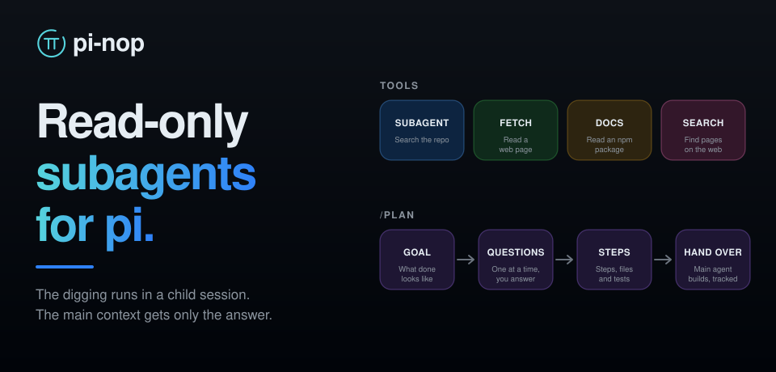

<div align="center">



# pi-nop

**Read-only subagents for [pi](https://pi.dev): repo search, web fetch, npm package docs, web
search, and a `/plan` panel.**

[](https://www.npmjs.com/package/pi-nop)
[](#license)
[](https://pi.dev/packages)
[](#development)
[](#development)

</div>

## What it does

Reading a big file, a web page or a package's types fills the main context with text it needs
once. pi-nop gives that work to a subagent in its own session. Only the answer comes back.

- **Read-only.** No subagent can edit, write or run commands.
- **Built for local models.** Guards catch a model that loops or stalls and run it again.
- **One model per tool.** A small fast model can do the reading.

## Install

```bash
pi install npm:pi-nop
```

Needs pi 1.6.0 or later. `subagent-docs` needs `npm` and `tar` on PATH.

## Tools

| Tool | What it does |
|---|---|
| `subagent` | Searches the repo with read, grep, find and ls. |
| `subagent-fetch` | Reads one web page and answers a query about it. |
| `subagent-docs` | Answers from an npm package's types and README. |
| `web-search` | Up to 10 results. `exa` and `ddg` need no key. `brave` needs `BRAVE_SEARCH_API_KEY`. |

## Plan

`/plan [request]` opens a panel with four steps.

1. **Goal.** The subagent writes a `GOAL:` line. Type to change it, or accept it.
2. **Questions.** It asks one at a time. Pick an option or type an answer.
3. **Steps.** It writes `STEPS:`, `FILES:` and `VERIFY:`. Type a change or pick "Edit plan".
4. **Hand over.** "Send to main context" sends the plan to the main agent.

After hand over the footer shows `plan: files 3/4 · outside 1`. That's plan files written, and
other files written. `/plan` again shows each step marked.

## Config

`/nop-config` opens the panel. The file is `~/.pi/agent/pi-nop.json`.

| Key | Values | Default | Meaning |
|---|---|---|---|
| `subagent`, `subagent-fetch`, `subagent-docs` | `{model, thinkingLevel}` | the host's | Model per tool. `/plan` uses the `subagent` one. |
| `web-search.engine` | `exa`, `brave`, `ddg` | `exa` | Search engine. |
| `concurrency` | 1 to 4 | unlimited | Subagents running at once. |
| `staleMinutes` | `off`, 5, 10, 20, 30 | 10 | Kill a run when the model sends nothing this long. |
| `toolCallMinutes` | `off`, 5, 10, 15, 30 | 15 | Kill a run when one tool call takes this long. |
| `restarts` | 0 to 3 | 2 | How many times a killed run goes again. |

`PI_NOP_SEARCH_ENGINE` overrides the engine. `PI_NOP_SEARCH_ENDPOINT` overrides its URL.

### Guards

A guard that trips kills the run and starts it again with a note. Past `restarts` the run fails.

| Guard | Trips on |
|---|---|
| loop | The same tool call five times in twenty, or one file re-read five times with no new lines. |
| stale | No output for `staleMinutes`. The clock pauses while a tool runs. |
| tool-call | One tool call past `toolCallMinutes`. |
| ground | Eight tool calls in a row that repeat or fail. |
| churn | Tool results past twice the context window. |
| leak | Tool call markup in the final answer. |
| repeat | The same block of lines eight times in a row. One line alone does not count. |
| circle | Two sentences said eight times each in one thinking block. |

## Development

```bash
bun install
bun test
npm run lint
```

## License

[MIT](./LICENSE) © Edgars Mjasnikovs
